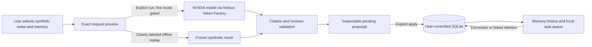

# Data flow

Loopback server controls API authorization. Cloud path sends selected excerpts/memory, query and fixed instructions; application payload never includes key or unrelated local files. API key is transport authentication only. Data sources/model text cannot choose destinations or execute tools. Live path requires validated account/model/terms/token bounds and human cap. Local path makes no model request and cannot establish NVIDIA/Nebius compliance.

SQLite holds sources, memory/provenance, pending proposals, completed receipts and task records. Deletion conservatively removes source-linked closure and rejects old revisions, preventing late-response regeneration. It does not prove physical erasure of SQLite/backups or provider deletion. Font assets served locally. No remote rendering resources.
